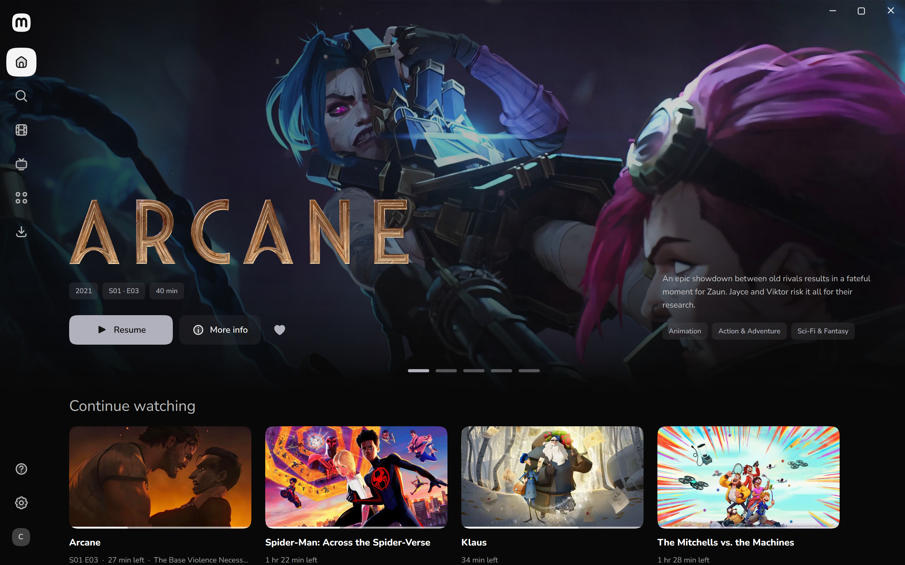
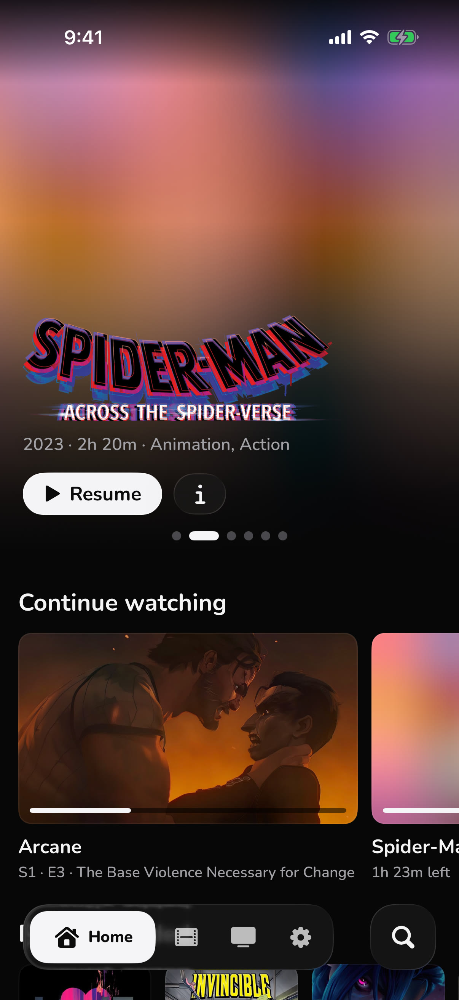
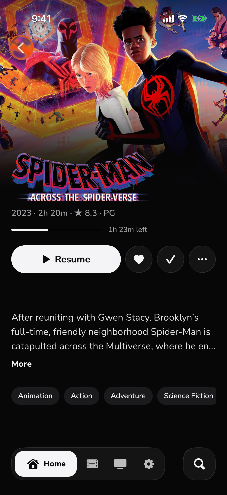
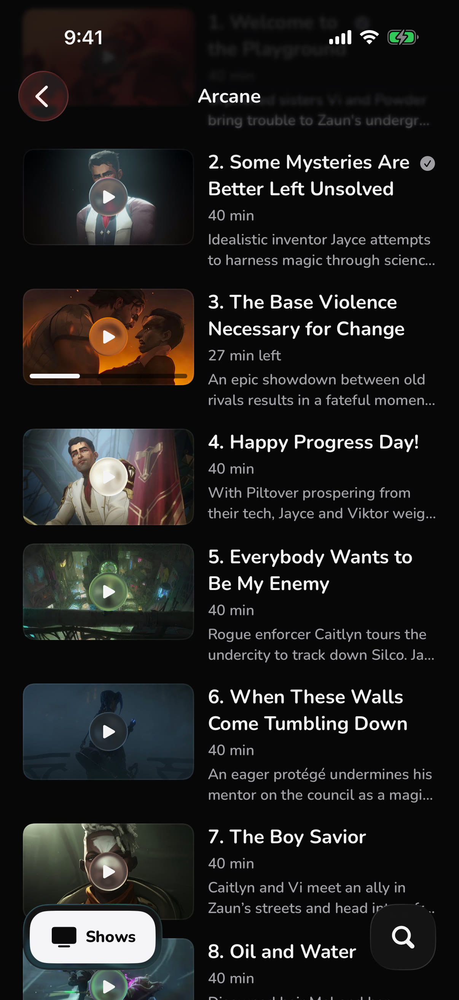
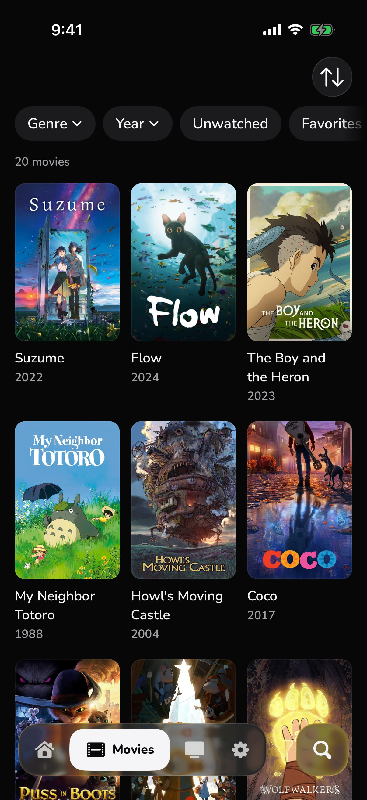
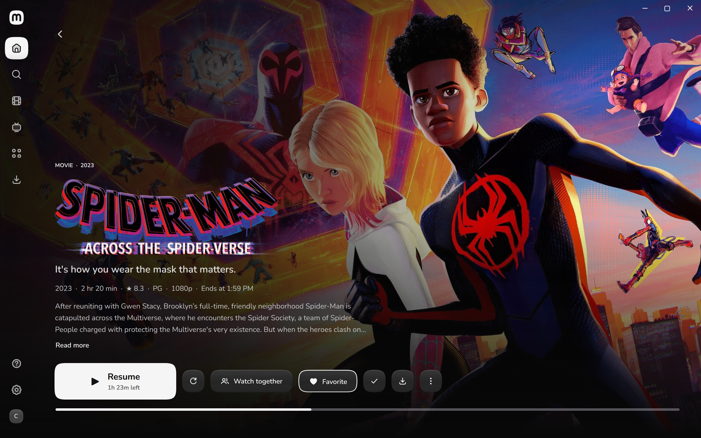
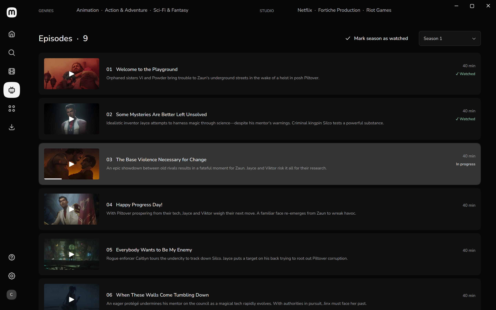
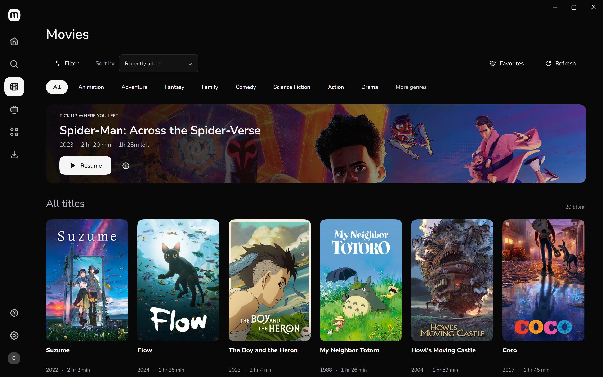
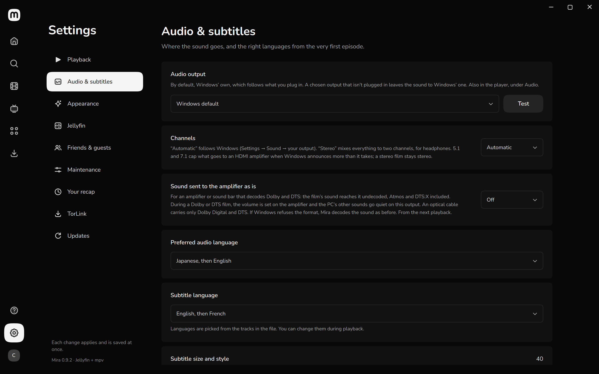

<div align="center">
  
  <h1>Mira</h1>
  <p><strong>Your Jellyfin library, like at the movies.</strong></p>
  <p>Apps for Windows, Mac and iPhone that play everything themselves.<br />Free, with no account or subscription, and nothing leaves your server.</p>
  <p>
    <a href="https://github.com/sasou-web/Mira/releases/latest"></a>
    <a href="LICENSE"></a>
    <a href="https://github.com/sasou-web/Mira/actions/workflows/ci.yml"></a>
    <a href="https://discord.gg/Bh3F6PDUvB"></a>
  </p>
  <p>
    <a href="https://github.com/sasou-web/Mira/releases/latest"><strong>Download for Windows</strong></a> ·
    <a href="https://wiki.miracinema.app/mac/">Mac</a> ·
    <a href="https://wiki.miracinema.app/iphone/">iPhone</a> ·
    <a href="https://discord.gg/Bh3F6PDUvB">Discord</a> ·
    <a href="docs/README.fr.md">Français</a>
  </p>
</div>



## Why Mira?

[Jellyfin](https://jellyfin.org) keeps your films and series on your PC and serves them anywhere. Mira is the pleasant way to watch them, in English or in French.

- **Beautiful from the start.** Posters, large artwork, summaries, cast, sagas: your library looks like a streaming service.
- **Pick up where you left off.** On the PC, the Mac or the iPhone, Continue Watching takes you back to the right minute, and the next episode follows on its own.
- **Playback inside Mira.** The mpv engine plays almost any file as it is: subtitles, audio tracks, chapters, intros skipped in one gesture.
- **Watch together.** A link is enough to start the same film at a friend's, at the same time, each at home.
- **No complicated setup.** No Jellyfin yet? Mira installs and prepares it for you, firewall and Tailscale included.
- **Your privacy stays at home.** No Mira account, no ads, nothing collected; only the update check contacts GitHub, and Tailscale only if you sign Mira in to it. **Settings → Privacy** lists every connection, with its switch.

## On your iPhone too

Mira for iPhone is a native app with its own player (Picture in Picture, AirPlay), Watch together and, away from home, Built-in Tailscale, with no Tailscale app to install. It is installed with AltStore and your free Apple ID, and refreshed each week by the server PC ([guide](https://wiki.miracinema.app/iphone/)). Mira web, which Jellyfin served to phones until 0.9.3, has ended: on Android, there is no Mira for now.

<table>
  <tr>
    <td width="25%"></td>
    <td width="25%"></td>
    <td width="25%"></td>
    <td width="25%"></td>
  </tr>
</table>

**Watch with someone who has no account.** Your party link, always the same, opens Mira for your friend on Windows, Mac or iPhone, with no account and no Tailscale, straight into your “Watch together” group. Each guest gets a device of their own, and when you take one back, they are out at once. It goes through Tailscale Funnel, which opens only Mira to the Internet, never the rest of Jellyfin (details, in French, in [SECURITY.md](SECURITY.md#liens-dinvités-inviter-par-lien)).

## On your computer

<table>
  <tr>
    <td width="50%"></td>
    <td width="50%"></td>
  </tr>
  <tr><td align="center">A film's page</td><td align="center">A series and its episodes</td></tr>
  <tr>
    <td width="50%"></td>
    <td width="50%"></td>
  </tr>
  <tr><td align="center">All your films</td><td align="center">Languages and subtitles</td></tr>
</table>

<sub>Captures of the real application, connected to a demo Jellyfin server (placeholder videos; posters and summaries from TMDb). <i>Arcane</i> © Riot Games, Fortiche; <i>Spider-Man: Across the Spider-Verse</i> © Sony Pictures Animation; the other titles belong to their rights holders.</sub>

## Install

| On | What you need | How |
| --- | --- | --- |
| **Windows** 10 or 11 (x64) | `Mira-x.y.z-win-x64-setup.exe` | Run the installer, connect your Jellyfin server, or let Mira install one. [Guide](https://wiki.miracinema.app/windows/) |
| **Mac** with Apple silicon, macOS 15 or later | `Mira-x.y.z-mac-arm64.dmg` | Drag Mira to Applications, allow it once (it is not signed by Apple). Or with [Homebrew](https://github.com/sasou-web/homebrew-mira): `brew install --cask sasou-web/mira/mira`. [Guide](https://wiki.miracinema.app/mac/) |
| **iPhone, iPad** (trial) | AltStore Classic, iOS 26 | The native app: library, search, its own player (Picture in Picture, AirPlay), sleep timer, Watch together and, away from home, Built-in Tailscale. Installed with your free Apple ID, refreshed each week by the server PC. [Guide](https://wiki.miracinema.app/iphone/) |

Every file is in the [latest release](https://github.com/sasou-web/Mira/releases/latest). You need a Jellyfin 10.9 or later server (Mira’s extension for Jellyfin is tried on 10.9, 10.10, 12.1 and 12.4 at every change). Until the Windows files are signed, SmartScreen may show a warning: **More info → Run anyway** ([how to verify a download](https://wiki.miracinema.app/verify/): SHA-256, build attestation, VirusTotal). Mira then updates itself.

<details>
<summary>The other Windows files</summary>

- **Mira-x.y.z-win-x64-portable.exe**: one file that runs as it is. Keep it in a writable folder of its own: it creates its `data` folder there.
- **Mira-x.y.z-win-x64.zip**: the application's whole folder, to extract anywhere.

The .NET runtime is included. The mpv player engine (31 MB) is downloaded on request, from mpv's Windows builds, SHA-256 checked; one already installed with mpv.net or Jellyfin MPV Shim is reused. The optional downloads page turns TorLink on in one click; TorLink is an independent project, and Mira provides no sources or content.
</details>

## Status

Mira is a preview: it is used every day, but some things are still missing (signed Windows and Mac files) and HDR, multichannel audio and multiple monitors have not been tried everywhere.

- [Guides for every app: features, shortcuts, help](https://wiki.miracinema.app/)
- [Release history](https://github.com/sasou-web/Mira/releases)
- [Report a bug](https://github.com/sasou-web/Mira/issues/new/choose) or [a vulnerability](SECURITY.md)
- [Talk about Mira on Discord](https://discord.gg/Bh3F6PDUvB): help, ideas, new releases

## Code signing policy

- **What is signed today.** Nothing with a code signing certificate. The Windows files (the installer `Mira-X.Y.Z-win-x64-setup.exe`, the portable `Mira-X.Y.Z-win-x64-portable.exe`, `Mira-X.Y.Z-win-x64.zip`) carry no Authenticode signature, so Windows SmartScreen asks for confirmation the first time; Mira for Mac is signed ad hoc, without an Apple developer account, so macOS asks once too. A free certificate from an open source signing programme was asked for and not granted for such a young project; Mira will apply again later. The update manifest of each release is signed with the maintainer's own key, and Mira installs an update only if that signature checks out.
- **Where the files come from.** GitHub Actions builds every release file from the `main` commit the release publishes, never on a PC ([`windows.yml`](.github/workflows/windows.yml), [`mac.yml`](.github/workflows/mac.yml), [`ios.yml`](.github/workflows/ios.yml), [`web.yml`](.github/workflows/web.yml)), with each file's SHA-256 beside it, in an immutable release: once published, neither the tag nor a file can change.
- **Verifying a download.** Compare the file's SHA-256 with the `.sha256` beside it. From the version after 0.9.5, each file also carries a GitHub build attestation (`gh attestation verify <file> -R sasou-web/Mira` names the workflow and the commit that built it), the release itself is attested (`gh release verify`), and the release workflow sends the Windows and Mac files to VirusTotal. Step by step: [Verify your download](https://wiki.miracinema.app/verify/).
- **Team roles.** [sasou-web](https://github.com/sasou-web) (ogsas) is the maintainer: his GitHub account is the only one that writes to `main` and he alone starts a release (`tools/release.ps1`), with two-factor authentication. Changes are written and tested by the Claude AI assistant (Anthropic) at his request, under his account and responsibility; nothing enters a release before GitHub Actions' checks pass (build, tests, the Jellyfin extension against real Jellyfin servers from 10.9 to the latest).
- **Privacy policy.** Mira sends nothing to anyone but your Jellyfin server unless you ask for it (installing the mpv engine, Jellyfin, Node.js or TorLink, opening a link, signing in to Built-in Tailscale), with two exceptions: the update check against GitHub (this repository's releases API), at startup then every 6 hours, on Windows and on Mac, and, on Windows on Jellyfin's PC with an administrator account, a look at Microsoft's winget catalogue on GitHub once a day for a newer Jellyfin. Both send nothing but the request itself (IP address, Mira's version) and report nothing; **Settings → Privacy** turns each off. Nothing is collected about you or your library. The services it contacts have their own privacy policies: [GitHub](https://docs.github.com/en/site-policy/privacy-policies/github-general-privacy-statement) (updates, the Jellyfin extension), [npm](https://docs.npmjs.com/policies/privacy) (TorLink), the [OpenJS Foundation](https://privacy-policy.openjsf.org/) (Node.js, from nodejs.org), SourceForge (the mpv engine), Jellyfin (its installer) and [Tailscale](https://tailscale.com/privacy-policy) (Built-in Tailscale: once signed in, its servers see the device’s name, its system and its IP addresses, and it asks your router to open a port (UPnP, NAT-PMP, PCP) for a direct connection rather than a relay; videos stay end-to-end encrypted); once started, TorLink is a BitTorrent client (peers, trackers, router), and its terminal relies on [WebView2](https://learn.microsoft.com/microsoft-edge/webview2/concepts/data-privacy), a Windows component that follows Windows’ diagnostic settings. Mira for iPhone talks only to your Jellyfin server, and to Tailscale if you turn Built-in Tailscale on, and never looks for updates itself. Details: [SECURITY.md](SECURITY.md).

## Build

<details>
<summary>Build, test and release Mira</summary>

On Windows, install the .NET 10 SDK, then run from the repository root:

```powershell
dotnet restore Mira.sln --configfile NuGet.Config
dotnet build Mira.sln -c Release --no-restore
dotnet run --project tests/Mira.Tests/Mira.Tests.csproj -c Release --no-build
dotnet run --project src/Mira.Desktop/Mira.Desktop.csproj -- --demo --data .artifacts/dev-profile
./tools/package.ps1
./tools/release.ps1   # the GitHub release vX.Y.Z: Windows, Mac, iPhone and the Jellyfin extension from GitHub Actions, signed manifest, notes (gh)
```

Tests use an executable harness, not `dotnet test`; a failure does not stop the following tests, `--filter <text>` picks tests by name, and `tests/Mira.Core.Tests` (the tests free of WPF) also runs on Linux and macOS. Baseline tests require neither a live server nor libmpv. The captures on this page are made by the [`gallery.yml`](.github/workflows/gallery.yml) workflow (`tools/gallery`). [Contribution guide](CONTRIBUTING.md).
</details>

## Licence

Original code: [MIT](LICENSE). Dependencies retain their [own licences](THIRD_PARTY_NOTICES.md). Mira is an independent project, not affiliated with Jellyfin; no film, episode or account comes with it.
