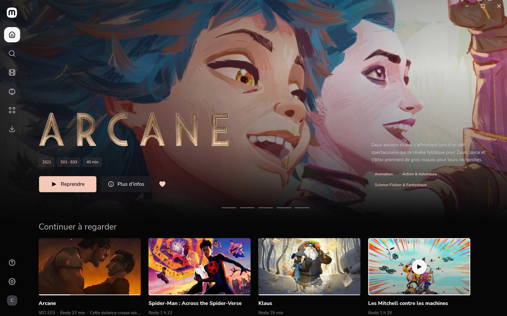
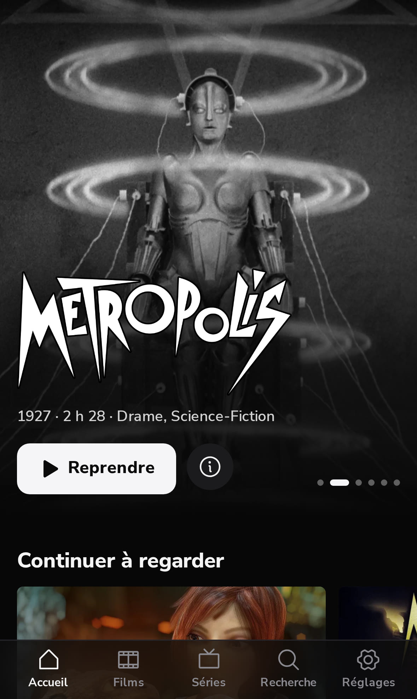
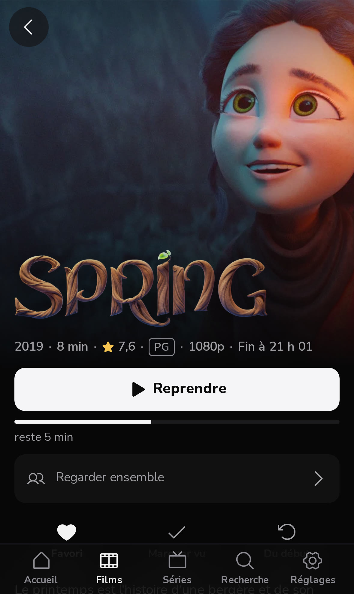
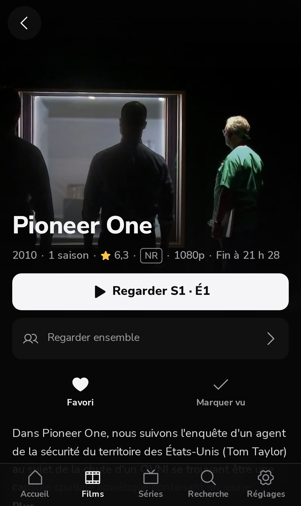
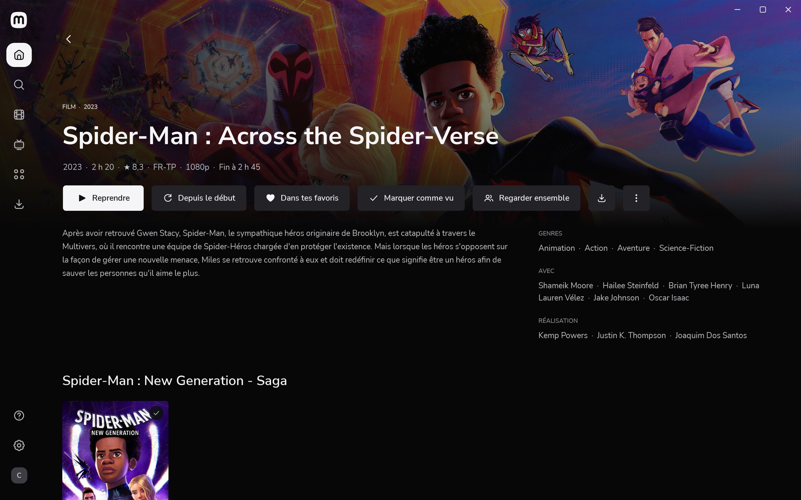
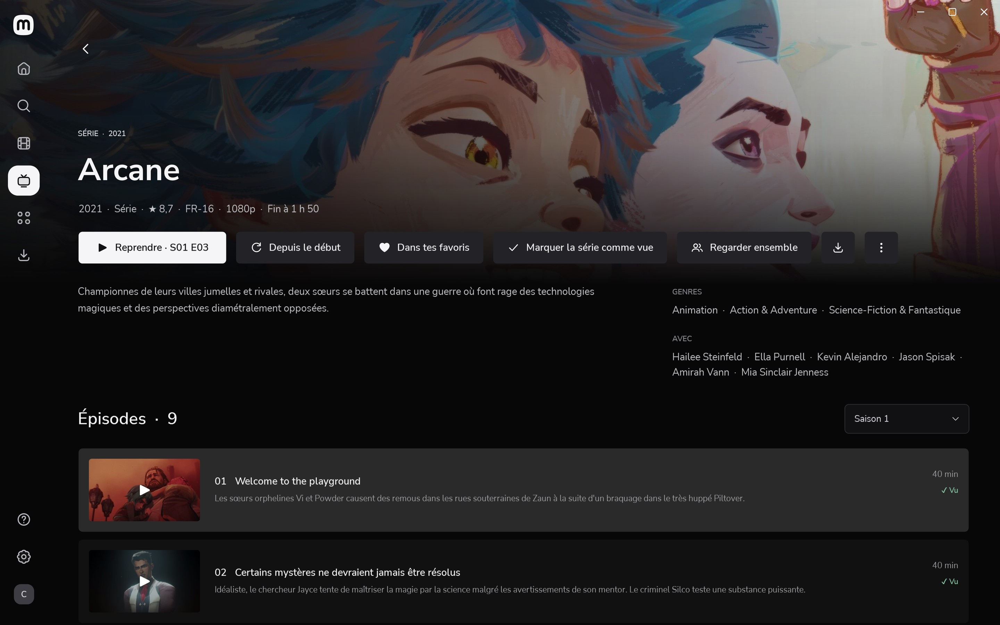
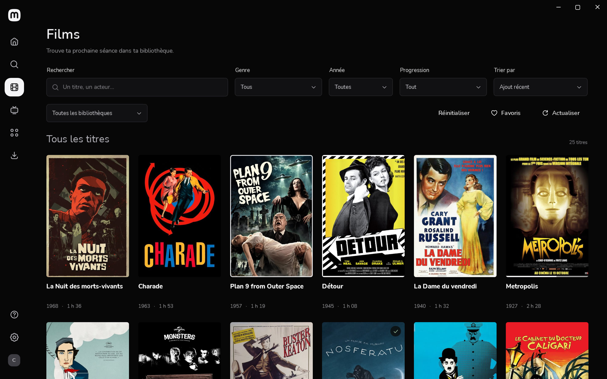
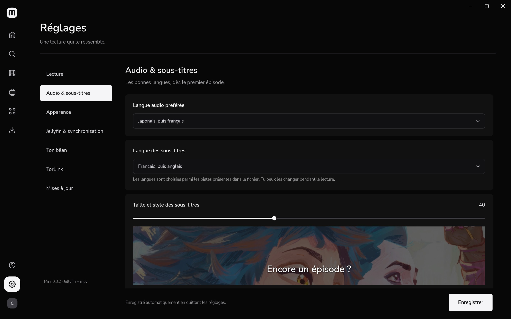

<div align="center">
  
  <h1>Mira</h1>
  <p><strong>Ta bibliothèque Jellyfin, comme au cinéma.</strong></p>
  <p>Une app pour Windows et Mac qui lit tout elle-même, et Mira web pour ton iPhone ou ton Android.<br />Gratuite, sans compte ni abonnement, et rien ne quitte ton serveur.</p>
  <p>
    <a href="https://github.com/sasou-web/Mira/releases/tag/v0.8.2"></a>
    <a href="LICENSE"></a>
    <a href="https://github.com/sasou-web/Mira/actions/workflows/ci.yml"></a>
  </p>
  <p>
    <a href="https://github.com/sasou-web/Mira/releases/tag/v0.8.2"><strong>Télécharger pour Windows</strong></a> ·
    <a href="docs/INSTALLATION-MAC.md">Mac</a> ·
    <a href="docs/INSTALLATION-WEB.md">iPhone et Android</a> ·
    <a href="docs/README.en.md">English</a>
  </p>
</div>



## Pourquoi Mira ?

[Jellyfin](https://jellyfin.org) range tes films et tes séries sur ton PC et te les sert partout. Mira est la façon agréable de les regarder.

- **Tout est beau dès l’ouverture.** Affiches, grands visuels, résumés, distribution, sagas : ta bibliothèque ressemble à celle d’un service de streaming.
- **Tu reprends où tu en étais.** Sur le PC, le Mac ou le téléphone, « Continuer à regarder » te ramène à la bonne minute, et l’épisode suivant s’enchaîne seul.
- **La lecture se fait dans Mira.** Le moteur mpv lit presque tous les fichiers tels quels : sous-titres, pistes audio, chapitres, intros passées d’un geste.
- **Regarder ensemble.** Un lien suffit pour lancer le même film chez un ami, en même temps, chacun chez soi.
- **Aucune installation compliquée.** Pas encore de Jellyfin ? Mira l’installe et le prépare pour toi. Le téléphone se connecte en scannant un QR code.
- **Ta vie privée reste chez toi.** Pas de compte Mira, pas de publicité, rien de collecté ; seule la recherche de mises à jour contacte GitHub.

## Sur ton téléphone aussi

Mira web est servie par ton propre serveur Jellyfin : rien à télécharger sur l’App Store, ni compte Apple. Sur iPhone, **Partager → Sur l’écran d’accueil**, et elle s’ouvre comme une app, à la maison comme ailleurs avec Tailscale.

<table>
  <tr>
    <td width="33%"></td>
    <td width="33%"></td>
    <td width="33%"></td>
  </tr>
  <tr>
    <td align="center">Accueil</td>
    <td align="center">Un film</td>
    <td align="center">Une série</td>
  </tr>
</table>

## Sur ton ordinateur

<table>
  <tr>
    <td width="50%"></td>
    <td width="50%"></td>
  </tr>
  <tr><td align="center">La fiche d’un film</td><td align="center">Une série et ses épisodes</td></tr>
  <tr>
    <td width="50%"></td>
    <td width="50%"></td>
  </tr>
  <tr><td align="center">Tous tes films</td><td align="center">Langues et sous-titres</td></tr>
</table>

<sub>Captures de la vraie application, connectée à un serveur Jellyfin de démonstration (vidéos factices ; affiches et résumés fournis par TMDb). <i>Arcane</i> © Riot Games, Fortiche ; <i>Spider-Man : Across the Spider-Verse</i> © Sony Pictures Animation ; les autres titres appartiennent à leurs ayants droit.</sub>

## Installer

| Sur | Ce qu’il faut | Comment |
| --- | --- | --- |
| **Windows** 10 ou 11 (x64) | `Mira-0.8.2-win-x64-setup.exe` | Lance l’installateur, connecte ton serveur Jellyfin, ou laisse Mira l’installer. [Guide](docs/INSTALLATION.md) |
| **Mac** à puce Apple, macOS 15 ou plus | `Mira-0.8.2-mac-arm64.dmg` | Glisse Mira dans Applications, autorise-la une fois (elle n’est pas signée par Apple). [Guide](docs/INSTALLATION-MAC.md) |
| **iPhone, iPad, Android** | Rien à télécharger | Dans Mira pour Windows : **Guide → Mira sur ton téléphone → Tout préparer**, puis scanne le QR code. [Guide](docs/INSTALLATION-WEB.md) |

Tous les fichiers sont dans la [release 0.8.2](https://github.com/sasou-web/Mira/releases/tag/v0.8.2). Il te faut un serveur Jellyfin 10.9 ou plus récent. Tant que les fichiers Windows ne sont pas signés, SmartScreen peut afficher un avertissement : **Informations complémentaires → Exécuter quand même**. Mira se met ensuite à jour toute seule.

<details>
<summary>Les autres fichiers pour Windows</summary>

- **Mira-0.8.2-win-x64-portable.exe** : un seul fichier à lancer tel quel. Range-le dans son propre dossier : il y crée son dossier `data`.
- **Mira-0.8.2-win-x64.zip** : le dossier complet de l’application, à extraire où tu veux.

Le runtime .NET est inclus. Le moteur vidéo mpv (31 Mo) est téléchargé à la demande, depuis les builds Windows de mpv, et son empreinte est vérifiée ; un moteur déjà installé avec mpv.net ou Jellyfin MPV Shim est réutilisé. La page **Téléchargements**, facultative, active TorLink d’un clic ; TorLink est un projet indépendant, et Mira ne fournit ni sources ni contenus.
</details>

## Où en est Mira

Mira **0.8.2** est une préversion : elle sert tous les jours, mais certaines choses manquent encore (choix entre plusieurs versions d’un même titre, collections modifiables, signature des fichiers Windows) et le HDR, le multicanal et le multi-écrans n’ont pas été essayés partout. L’interface est en français.

- [Toutes les fonctions et les raccourcis](docs/USER_GUIDE.md)
- [Historique des versions](CHANGELOG.md)
- [Signaler un bug](https://github.com/sasou-web/Mira/issues/new/choose) ou [une faille de sécurité](SECURITY.md)

## Politique de signature du code

*Code signing policy.* Free code signing provided by [SignPath.io](https://signpath.io), certificate by [SignPath Foundation](https://signpath.org).

- **Ce qui est signé.** Les fichiers Windows de chaque release : l’installateur `Mira-X.Y.Z-win-x64-setup.exe`, l’exécutable portable `Mira-X.Y.Z-win-x64-portable.exe` et, dans `Mira-X.Y.Z-win-x64.zip`, `Mira.exe`, `Mira.dll` et `Mira.Core.dll`. GitHub Actions ([`windows.yml`](.github/workflows/windows.yml)) les construit depuis le commit de `main` que la release publie, jamais sur un PC ; SignPath Foundation les signe après l’approbation du mainteneur ; ils sont publiés d’un coup, avec leurs empreintes SHA-256, dans une release immuable. Avant de signer, SignPath vérifie que chaque fichier porte le nom de produit « Mira » et la version de la release (configurations d’artefact dans [`installer/signpath/`](installer/signpath)). Le désinstallateur créé par Inno Setup, le runtime .NET et les bibliothèques tierces du dossier gardent leur signature d’origine ou n’en ont pas. Mira pour Mac est signée ad hoc, sans compte Apple ; Mira web (l’extension Jellyfin) n’est pas un exécutable Windows.
- **Rôles.** [sasou-web](https://github.com/sasou-web) (ogsas) est le mainteneur : son compte GitHub est le seul à écrire sur `main`, lui seul lance une release (`tools/release.ps1`) et approuve chaque demande de signature dans SignPath, avec l’authentification à deux facteurs sur GitHub et sur SignPath. Les modifications sont écrites et testées par l’assistant IA Claude (Anthropic), sur ses demandes, sous son compte et sa responsabilité ; rien n’entre dans une release sans la réussite des contrôles de GitHub Actions (compilation, tests, Mira web contre un vrai Jellyfin).
- **Vie privée.** Mira ne transmet aucune information à d’autres systèmes que ton serveur Jellyfin, sauf à ta demande (installer le moteur mpv, Jellyfin, Node.js ou TorLink, ouvrir un lien), à une exception près : la recherche de mises à jour sur GitHub (l’API des releases de ce dépôt), à l’ouverture puis toutes les 6 h sous Windows, à chaque ouverture sur Mac. Elle n’envoie que la requête elle-même (adresse IP, version de Mira) et ne rapporte rien ; sous Windows, **Réglages → Mises à jour** l’arrête. Rien n’est collecté, ni sur toi ni sur ta bibliothèque. Les services contactés ont leurs propres politiques de confidentialité : [GitHub](https://docs.github.com/en/site-policy/privacy-policies/github-general-privacy-statement) (mises à jour, Mira web), [npm](https://docs.npmjs.com/policies/privacy) (TorLink), la [fondation OpenJS](https://privacy-policy.openjsf.org/) (Node.js, depuis nodejs.org), SourceForge (le moteur mpv) et Jellyfin (son installateur) ; une fois lancé, TorLink est un client BitTorrent (pairs, trackers, routeur), et son terminal repose sur [WebView2](https://learn.microsoft.com/microsoft-edge/webview2/concepts/data-privacy), composant de Windows qui suit les réglages de diagnostic de Windows. Le détail : [SECURITY.md](SECURITY.md).
- **Où en est la signature.** Tout est prêt, mais la demande d’adhésion à SignPath Foundation n’est pas encore déposée : jusqu’à la 0.8.2, les fichiers Windows ne sont pas signés, et SmartScreen demande confirmation.

## Développer

<details>
<summary>Compiler, tester et publier Mira</summary>

Prérequis : Windows x64 et SDK .NET 10. Les tests de base n’exigent ni serveur Jellyfin ni libmpv.

```powershell
git clone https://github.com/sasou-web/Mira.git
cd Mira
dotnet restore Mira.sln --configfile NuGet.Config
dotnet build Mira.sln -c Release --no-restore
dotnet run --project tests/Mira.Tests/Mira.Tests.csproj -c Release --no-build
node --test tools/web/unit/*.test.mjs    # décisions du lecteur de Mira web, Node.js 22
dotnet run --project src/Mira.Desktop/Mira.Desktop.csproj -- --demo --data .artifacts/dev-profile
```

```powershell
./tools/package.ps1          # Archive, exécutable portable, installateur (Inno Setup 6) et leurs empreintes, pour un essai local
./tools/release.ps1          # La release GitHub vX.Y.Z : Windows (signé par SignPath Foundation), Mac et Mira web par GitHub Actions, manifeste signé, notes (gh)
./tools/capture-gallery.ps1  # Captures avec un profil fictif isolé
./tools/torlink-check.ps1    # TorLink réel dans Mira, état et bibliothèque isolés
./tools/update-check.ps1     # Mises à jour de bout en bout : archive, portable et installateur, flux local et clé d’essai
```

Les captures de cette page sont refaites par le workflow [`gallery.yml`](.github/workflows/gallery.yml) (`tools/gallery`).

| Dossier | Rôle |
| --- | --- |
| `src/Mira.Desktop` | Interface WPF, lecteur mpv, intégration Windows, terminal TorLink |
| `src/Mira.Mac` | Mira pour Mac (Avalonia), même moteur mpv |
| `src/Mira.Core` | API Jellyfin, cache SQLite, synchronisation, règles de lecture et rangement des téléchargements |
| `src/Mira.Web` et `src/Mira.Jellyfin` | Mira web et l’extension Jellyfin qui la sert |
| `tests/Mira.Core.Tests` | Tests sans WPF (comportement, persistance, mises à jour), lancés aussi sous Linux |
| `tests/Mira.Tests` | Les mêmes, puis ceux de l’app Windows |
| `tools` | Publication, captures, contrôles, serveur fictif et import des ressources ; `tools/web/unit` : tests Node de Mira web |
| `docs` | Guides, architecture, galerie et validation |

La compilation et les tests de base tournent sur Windows dans GitHub Actions, les tests sans WPF aussi sous Linux ; Mira web est contrôlée dans Chromium et Safari contre un vrai Jellyfin. Tout est décrit dans [docs/TESTS.md](docs/TESTS.md), [docs/ARCHITECTURE.md](docs/ARCHITECTURE.md) et [CONTRIBUTING.md](CONTRIBUTING.md).
</details>

## Licence et crédits

Code original sous [licence MIT](LICENSE). Le logo et les icônes sont dessinés pour Mira. Police **Nunito Sans** sous SIL OFL 1.1 ; composants .NET, SQLite, WebView2 et Windows selon leurs licences respectives ; **xterm.js** sous licence MIT pour le terminal TorLink. Les anciens SVG Phosphor sont conservés avec leur notice MIT. TorLink est un projet tiers, ni inclus ni modifié. Voir [THIRD_PARTY_NOTICES.md](THIRD_PARTY_NOTICES.md) pour les attributions et [licenses](licenses) pour les textes inclus. libmpv est un composant externe, non distribué avec Mira : Mira le télécharge depuis son distributeur quand tu le lui demandes.

Mira est un projet indépendant, sans lien avec Jellyfin. Aucun film, épisode ou compte n’est fourni avec Mira.
