# Mira 0.7.5 gallery

These **14 screenshots** are rendered by the real WPF app from its built-in made-up catalog. They contain no personal account, no real history and no media served by Jellyfin. The vector illustrations belong to the demo; with a connected server, posters and backdrops come from your library.

The screenshots show the browsing and settings views. They don’t show mpv’s native video or Windows’ system panels. How these components behave is documented in [VALIDATION.md](VALIDATION.md).

## Home and library

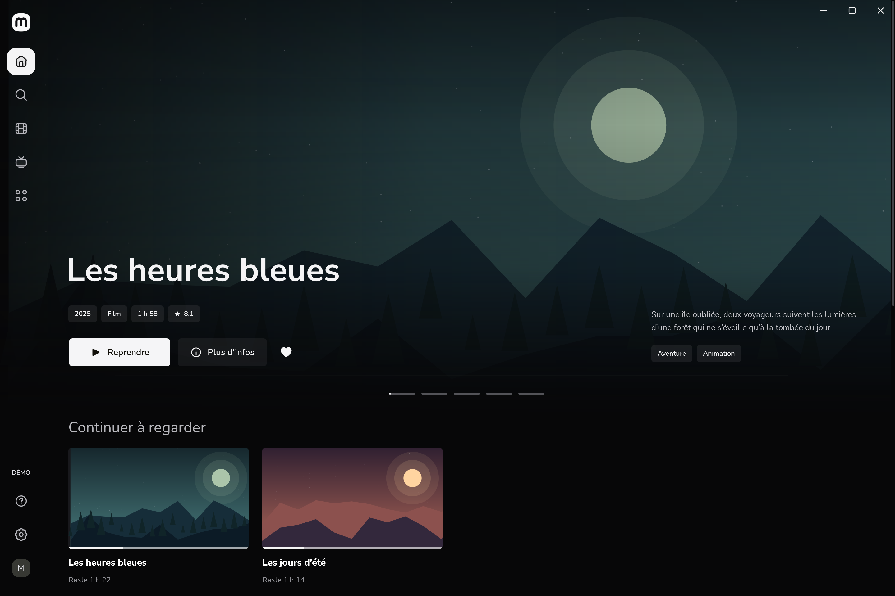

*Panoramic banner, duration indicators and resume playback.*

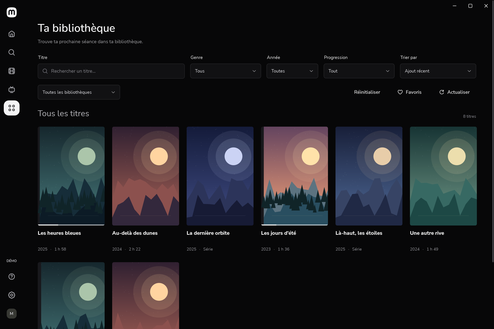

*Search, genres, year, progress and sorting.*

| Movies | Shows |
| --- | --- |
| 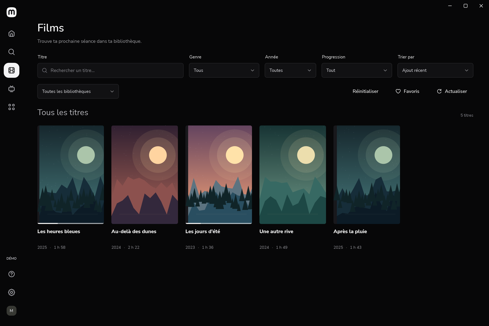 | 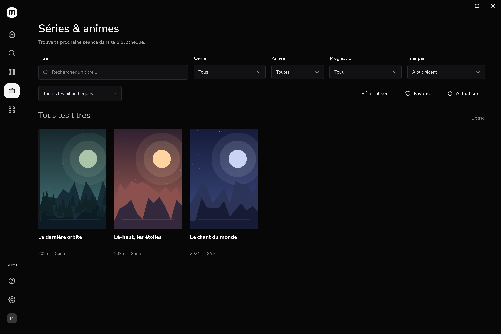 |

## Choose what to watch

| Favorites | A movie’s title page |
| --- | --- |
| 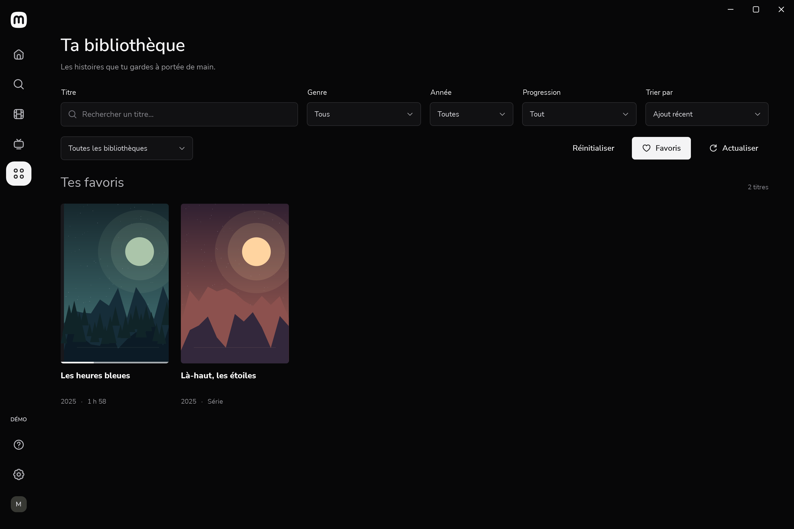 | 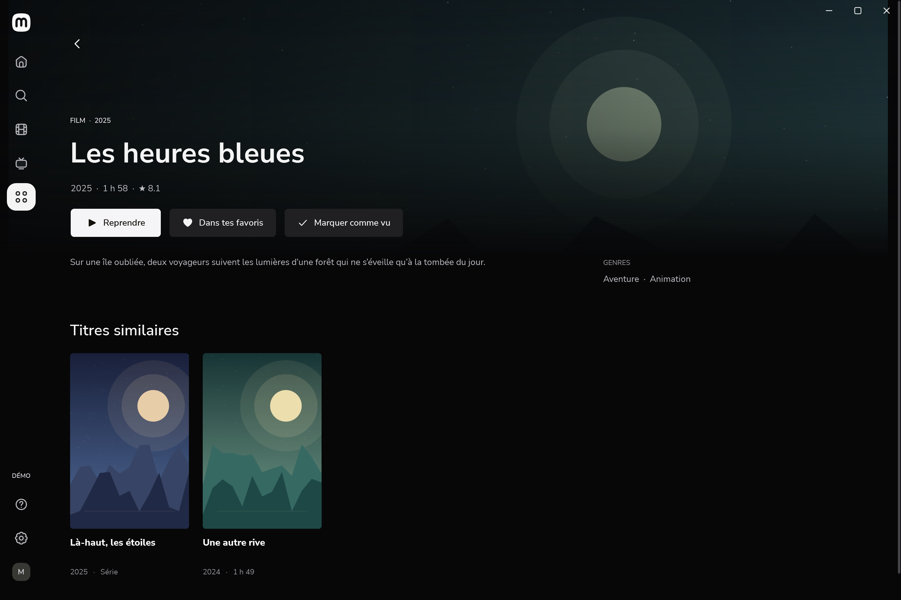 |

| Built-in hover | Search |
| --- | --- |
| 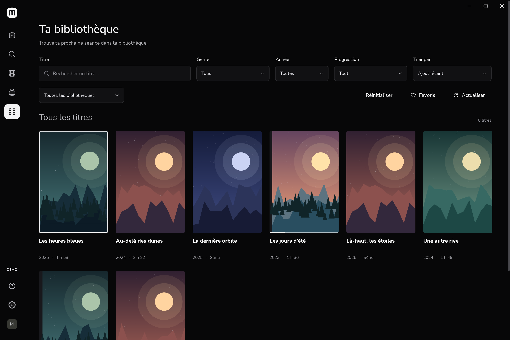 | 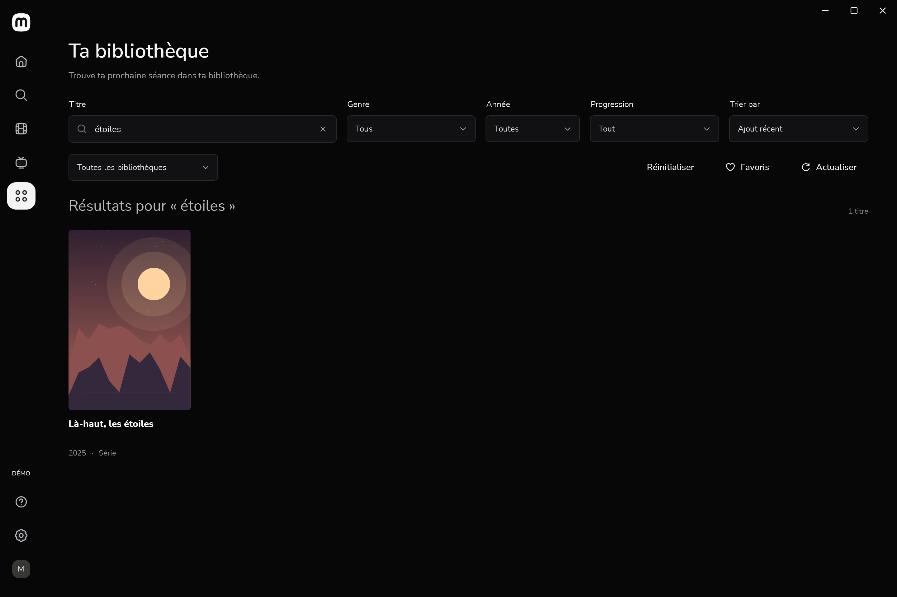 |

## Settings

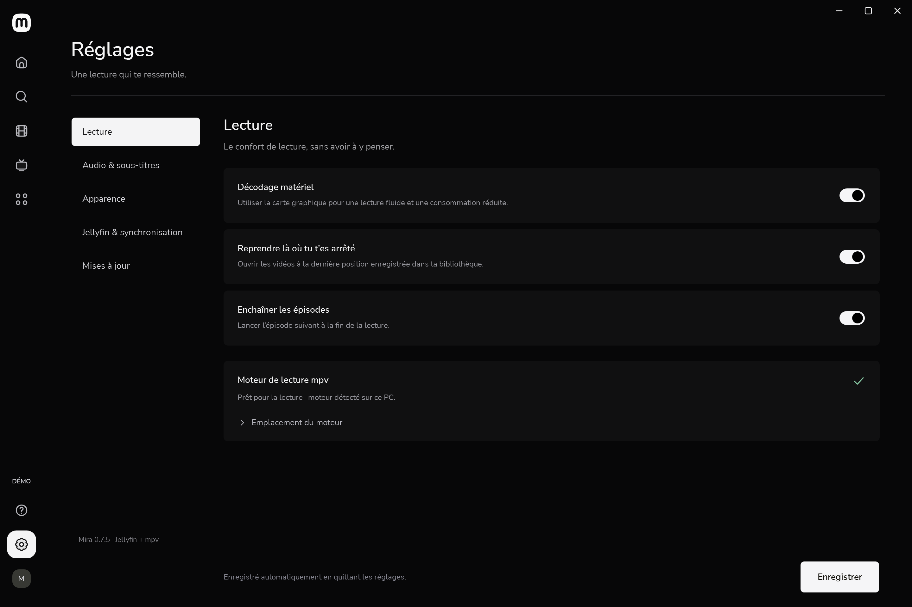

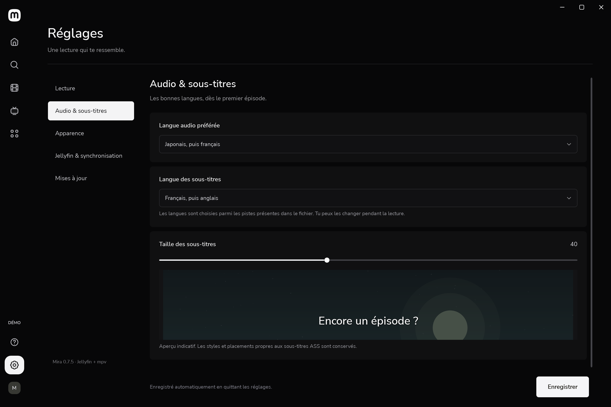

| Appearance | Jellyfin and sync |
| --- | --- |
| 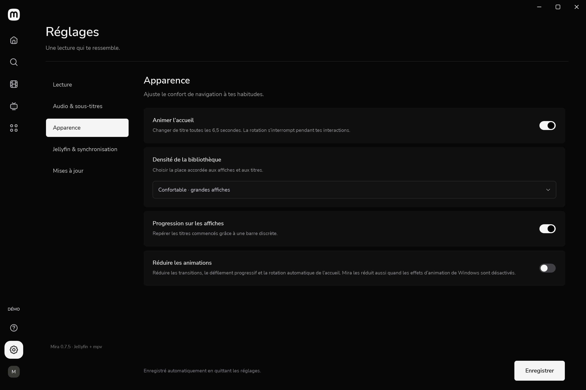 | 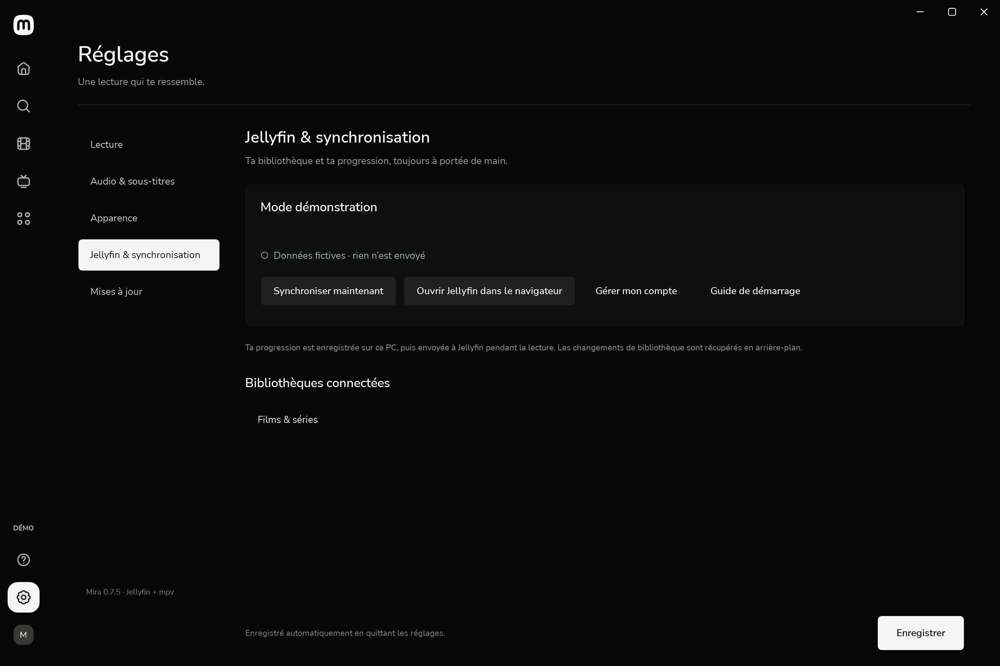 |

## Compact window and sign-in

| 1024 × 720 window | Sign-in |
| --- | --- |
| 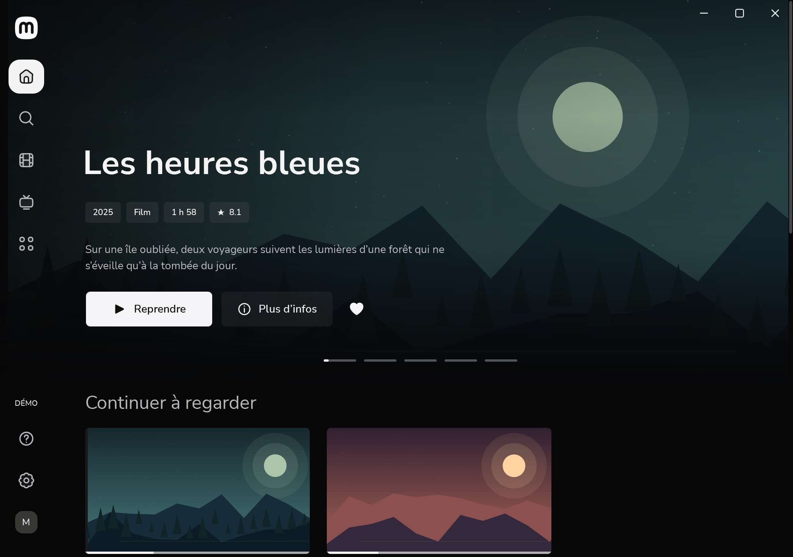 | 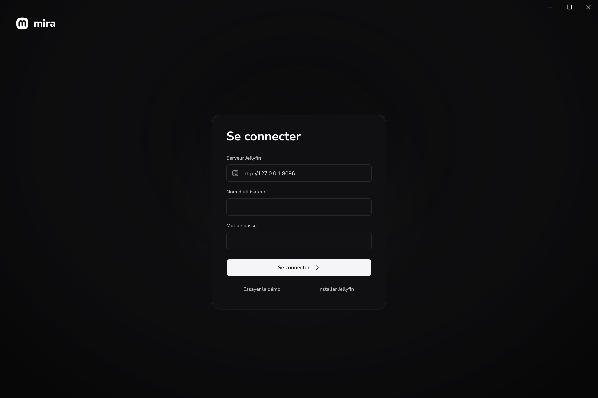 |

Regular screenshots use a window of 1440 × 960 WPF units. The export follows Windows’ DPI: the PNG resolution can be higher than these logical dimensions.

To reproduce them on Windows with the .NET 10 SDK:

```powershell
./tools/capture-gallery.ps1
```

The script creates a new profile under `.artifacts`, uses `--demo` and contacts no server. It only copies the numbered screenshots to `docs/screenshots`.
